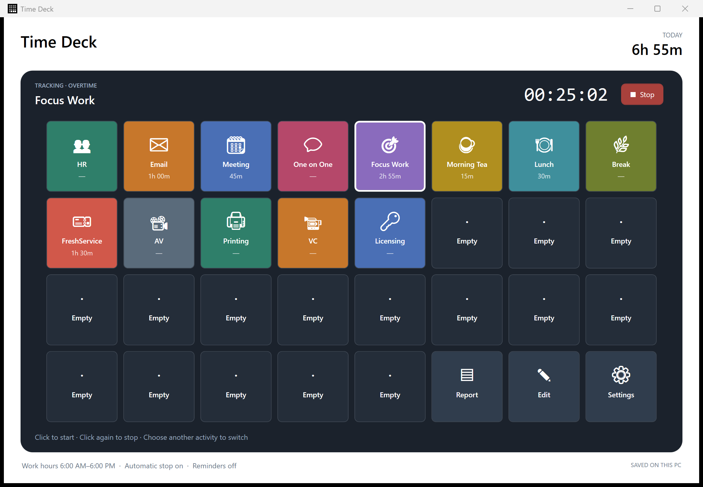
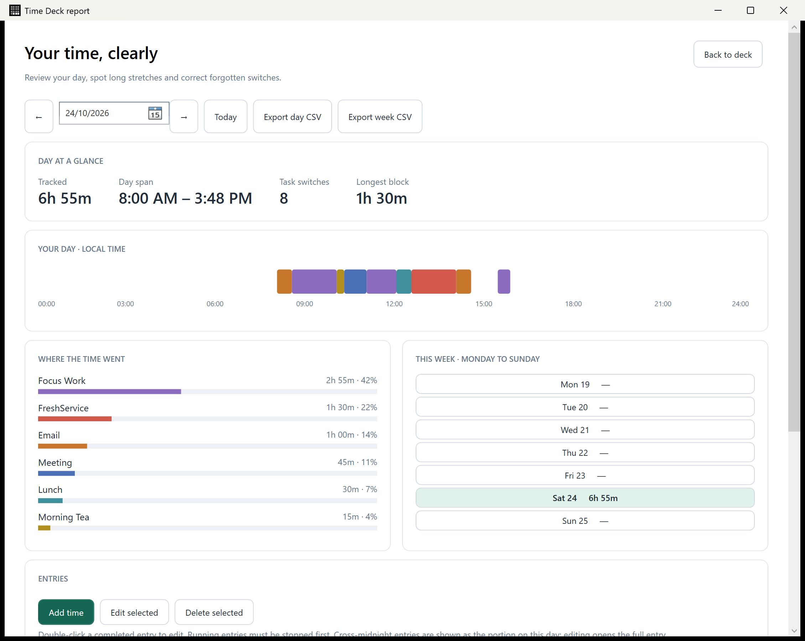

# Time Deck for Windows

A native Windows time tracker for a single user. Start and switch activities from a fixed 8 × 4 deck, review your day, and export your time to CSV. Your tracking data stays on your PC.

## Screenshots

The activity deck shows the running timer, today's total and time spent on each activity.



The report shows a daily timeline, activity breakdown, weekly totals and tools for correcting entries.



These captures use sample data. Images are stored in [`docs/images/`](docs/images/) and use relative paths so they render on GitHub and in a local Markdown preview.

## Get started

**Requirements:** Windows 10 version 2004 or later, or Windows 11, on x64. Building from source requires the .NET 10 SDK. The published build includes .NET and Windows App SDK dependencies, so the SDK is not required to run it.

From a PowerShell terminal in the repository root, publish and launch the app:

```powershell
.\scripts\publish.ps1
.\artifacts\TimeDeck\TimeDeck.exe
```

Keep the whole published `TimeDeck` folder together. You can move it to a permanent location before first use, particularly before enabling **Start with Windows**.

On first launch, the Windows app creates a fresh data file and a default deck with activities such as Email, Meeting and Focus Work. Choose **Edit** to customise it.

The original [`time-tracker.html`](time-tracker.html) is a separate browser app: open that file in a browser to use it. The Windows app does not import its data.

## Windows installer

To build the installer, install Inno Setup 6.3 or later alongside the .NET 10 SDK, then run:

```powershell
.\scripts\build-installer.ps1
```

The script publishes the self-contained app and compiles [`installer/TimeDeck.iss`](installer/TimeDeck.iss). It reads the version from the Windows project; version 1.0.0 produces `artifacts/installer/TimeDeck-Setup-1.0.0-win-x64.exe`. If Inno Setup is installed in a custom location, pass `-CompilerPath 'C:\path\to\ISCC.exe'`.

The installer uses the Time Deck icon and installs for the current user under `%LOCALAPPDATA%\Programs\TimeDeck`, without an administrator prompt. It adds a Start menu shortcut, offers an optional desktop shortcut, and registers an uninstaller in Windows Settings. Uninstalling keeps your tracking data and backups. The optional **Start with Windows** setting remains controlled by the app.

Before installing an update or uninstalling, choose **Exit** from the Time Deck tray menu so the timer is stopped and saved. Closing its window only hides it in the tray. Build output stays under the ignored `artifacts/` directory; the installer can be attached to a GitHub release separately. Locally built installers are unsigned.

## Use

- Click an activity to start. Click it again to stop, or another activity to switch immediately.
- **Report**, **Edit**, and **Settings** always occupy the bottom-right three buttons. The other 29 positions hold activities or empty slots.
- Choose **Edit** to add/customise/delete an activity. Drag a button to move it; dropping onto another activity swaps positions. The activity editor also has a destination-slot picker for keyboard access. Choose **Done editing** or press Escape to finish.
- Closing the window keeps Time Deck running in the system tray. Double-click its tray icon to reopen. The tray menu provides Open, Stop tracking, and Exit. Exit stops and saves the timer.
- Default work hours are **6 am–6 pm**, every day. Normal timers automatically end at the finish time. Starting outside those hours asks whether to track overtime, which has no cutoff. Settings can disable automatic stopping.
- Activity check-ins default to **60 minutes**. Unanswered reminders repeat every 15 minutes. **Still working** restarts the reminder period without resetting elapsed time; **Change activity** opens the deck, keeping the current timer until you switch or stop.
- Settings includes **Test notification** and optional **Start with Windows** (off initially). Enable Windows notifications for Time Deck and check Do Not Disturb if banners do not appear. Clicking a notification opens the deck.
- Reports show the day timeline, activity breakdown, weekly totals and editable entries. Add or correct entries manually; intentional overlaps require confirmation. CSV export supports the selected day or week. Running entries are excluded until stopped. Midnight-spanning entries are split into daily portions in reports and CSV; editing changes the full original entry.

Sleep counts as tracked time up to the cutoff. Reminders cannot appear while Windows is asleep or the app is exited; an overdue reminder is sent once on resume. A normal timer recovered after the finish time is stopped at its saved cutoff. Timers do not automatically start the next morning. Overnight work schedules and idle detection are not included.

## Data and backups

Data is saved under `%LOCALAPPDATA%\TimeDeck\state.json`, with an automatic previous-version backup at `%LOCALAPPDATA%\TimeDeck\state.backup.json`. Writes use atomic replacement. On corruption, a valid backup is recovered and the damaged primary is preserved. If neither file is readable, the app stops rather than overwriting your data.

Use **Settings → Export backup** to keep an independent JSON backup, and **Restore backup** to restore one. Restore previews activity/entry counts, requires tracking to be stopped, and writes a safety copy before replacement. A timer contained in a backup is stopped at its cutoff or the restore time. Your current Start with Windows preference is retained.

## Build and verify

Install the .NET 10 SDK on Windows, then run from this directory:

```powershell
dotnet test tests/TimeDeck.Tests
dotnet build src/TimeDeck.Windows
```

To run from source:

```powershell
dotnet run --project src/TimeDeck.Windows
```

To check the published app with UI automation:

```powershell
.\scripts\publish.ps1
.\scripts\smoke.ps1
```

Exit any running Time Deck instance through its tray menu before running the smoke check. The script uses a separate data directory under `artifacts/` and leaves your normal tracking data alone.

The app uses WPF for its interface, Windows Forms for its tray icon, and Windows App SDK app notifications. The core library is independent of UI and notification APIs.

### Launch options

| Option | Behaviour |
| --- | --- |
| `--tray` | Start hidden in the system tray. |
| `--data-dir <folder>` | Use a separate local data folder, for example when verifying the app. |

Only one instance per Windows user is allowed, including when a different data directory is supplied. A second launch reopens the existing instance.

See [verification notes](docs/verification.md) for checks performed and any remaining manual checks.
